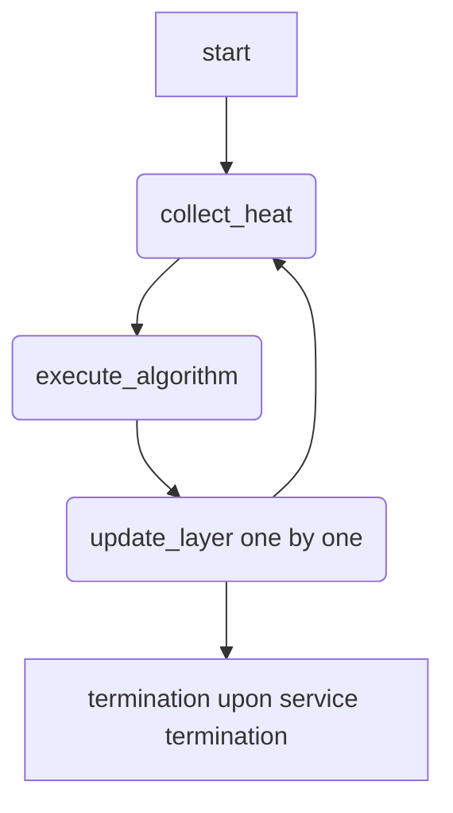

# Expert Parallelism Load Balancer (EPLB)

## 特性介绍

Expert balancing for MoE (Mixture of Experts) models in LLM (Large Language Model) serving is essential for optimal performance. Dynamically rearranging experts during inference can negatively impact TTFT (Time To First Token) and TPOT (Time Per Output Token), as it requires global synchronization pauses that stall all in-flight requests. The EPLB feature aims to minimize the impact of these pauses.

vLLM Ascend provides two EPLB integration paths:

- Model Runner V2 (MRv2) uses the upstream vLLM EPLB controller, configuration, default policy, load window, asynchronous worker, and rearrangement lifecycle. Ascend adds the HIXL and Gloo movement adapters and the `load_collection_phase` extension.
- Model Runner V1 (MRv1) retains the legacy vLLM Ascend dynamic, recording, and static EPLB modes.

The two paths use different switches and configuration schemas. Do not mix MRv1 environment variables or legacy fields with MRv2 EPLB configuration.

EPLB provides the following benefits:

- Reduced Latency: Dynamically balances expert loads to minimize TTFT and TPOT by distributing workloads evenly across experts.
- Adaptive Scaling: Automatically adjusts to workload fluctuations while maintaining stable performance.

**内容缺失，需要人工补齐。**

### 使用场景

**依据原文上下文内容重组，请进行人工校验。**

EPLB is applicable in the following deployment scenarios:

| Scenario | Applicability | Notes |
| --- | --- | --- |
| P node workloads with input sequences longer than 1024 tokens | Recommended | Shorter sequences may not benefit from EPLB. |
| D node workloads with experts per die at most 8 (at most 16 on 950DT Products) and per-die load at least 128 tokens | Recommended | Higher expert density or lower load reduces benefit. |
| Colocation (P node + D node) | Supported | Use MRv1 Dynamic EPLB or MRv2 with appropriate `load_collection_phase`. |

EPLB is not recommended in the following scenarios because the load-balancing benefit may not offset its runtime overhead:

- P node workloads with input sequences shorter than 1024 tokens.
- D node workloads where the number of experts per die is greater than 8 (greater than 16 on 950DT Products), or where the per-die load is below 128 tokens.

!!! warning
    Meeting the above conditions may lead to performance degradation. When there are around 8 experts per die, the EPLB benefit may be comparable to its overhead. Benchmark the actual workload and enable EPLB only after confirming a performance gain.

### 约束与限制

**依据原文上下文内容重组，请进行人工校验。**

| Dimension | Constraint |
| --- | --- |
| Hardware | 950PR&950DT Products do not support EPLB with W4A8 MXFP4 or W4A16 MXFP4 quantization. A2 does not support redundant experts; `num_redundant_experts` must be set to 0 on A2. All NPUs must have identical memory capacity and compute capabilities. Network bandwidth must support expert redistribution traffic (at least 10 Gbps recommended). |
| Deployment scenarios | Not recommended for P node workloads with input sequences shorter than 1024 tokens. Not recommended for D node workloads where experts per die is greater than 8 (greater than 16 on 950DT Products) or per-die load below 128 tokens. `/dev/shm` needs to be mounted for container. |
| Model | Applies only to MoE models that support expert parallelism and whose MoE quantization method exposes a complete expert-weight movement layout. MRv1 performance verified on DeepSeek-V3.1/R1. MRv2 model-level validation uses Qwen3-30B-A3B W8A8 with asynchronous EPLB. |
| Feature mutex | Weight offload and prefetch are incompatible with upstream EPLB on Ascend; enabling EPLB with `cpu_offload_gb > 0` or `offload_group_size > 0` raises a configuration error. MRv2 rejects elastic EP, legacy `dynamic_eplb`, recording/static-map fields, `DYNAMIC_EPLB`, and `EXPERT_MAP_RECORD`, as well as communicators other than Gloo and HIXL. Do not mix MRv1 environment variables or legacy fields with MRv2 EPLB configuration. |
| Software dependency | HIXL requires the CANN HIXL runtime and working device connectivity on every EPLB rank. Automatic selection requires the same HIXL binding class on every EPLB rank; each rank resolves either the official `hixl` Python package distributed with CANN HIXL or vllm_ascend's ctypes binding (driving `libcann_hixl.so` directly). If any rank has no usable binding or bindings differ, the whole group falls back to `torch_gloo` CPU staging. |
| Other | Static EPLB is scheduled for removal in v0.25.1. Validate the target model, topology, graph mode, and traffic independently before production use. |

MRv2 weight format support:

W8A8 is covered by an in-repository model-level regression test that runs on Ascend NPUs. Other enabled formats have not undergone the same level of validation and must be validated with the target model and hardware configuration before production deployment.

| Weight format | MRv2 EPLB | Notes |
| --- | --- | --- |
| BF16 / FP16 | Enabled | Uses the unquantized expert weights and biases. |
| W8A8 / W8A8 Dynamic | Enabled | Uses persistent per-expert weight and scale tensors. |
| W4A8 | Enabled | Uses persistent per-expert weight, scale, and scale-bias tensors. |
| W4A4 MXFP4 | Enabled | 950PR&950DT Products; keeps native ND expert tensors. |
| W8A8 MXFP8 | Enabled | 950PR&950DT Products; keeps native ND expert tensors. |
| W4A16 | Rejected | The expert-weight layout has not completed independent EPLB validation. |
| W4A16 MXFP4 | Rejected | The expert-weight layout has not completed independent EPLB validation. |
| W4A8 MXFP4 | Rejected | The expert-weight layout has not completed independent EPLB validation. |

MRv1 quantization and hardware support:

| QuantType | Supported Hardware |
| --- | --- |
| W8A8 / W8A8-Dynamic | A2, A3 |
| W4A8 (with fused MC2 enabled) | A2, A3 |
| MXFP4 | 950PR&950DT Products |
| MXFP8 | 950PR&950DT Products |

## 特性使用

!!! note
    The examples below may use a non-zero `num_redundant_experts` to demonstrate redundant-expert placement. This setting is only valid on hardware that supports redundant experts, such as A3 or 950PR&950DT Products. A2 does not support redundant experts; on A2, set `num_redundant_experts` to 0.

### 使用样例

**依据原文上下文内容重组，请进行人工校验。**

MRv2: Asynchronous EPLB

Select MRv2 explicitly when the model or environment does not select it by default. Enable expert parallelism and upstream EPLB. Ascend selects STAIR as the upstream policy default and automatically uses HIXL when available, falling back to Gloo otherwise. Movement is asynchronous only. The STAIR defaults do not require tuning.

1. Set environment variables to select MRv2 and clear legacy EPLB environment variables:

   ```bash
   export VLLM_USE_V2_MODEL_RUNNER=1
   unset DYNAMIC_EPLB
   unset EXPERT_MAP_RECORD
   ```

2. Start the vLLM service with EPLB enabled:

   ```bash
   vllm serve Qwen/Qwen3-30B-A3B \
     --tensor-parallel-size 16 \
     --enable-expert-parallel \
     --enable-eplb \
     --eplb-config.window_size 50 \
     --eplb-config.step_interval 50 \
     --eplb-config.num_redundant_experts 16 \
     --eplb-config.use_async true \
     --eplb-config.log_balancedness true \
     --eplb-config.log_balancedness_interval 1 \
     --additional-config '{"eplb_config":{"load_collection_phase":"all"}}'
   ```

   Parameters in the command:

   - `VLLM_USE_V2_MODEL_RUNNER=1`: Selects MRv2.
   - `--enable-expert-parallel`: Enables expert parallelism.
   - `--enable-eplb`: Enables EPLB.
   - `--eplb-config.window_size`: Number of recent steps for expert-load recording.
   - `--eplb-config.step_interval`: Interval between expert rearrangements.
   - `--eplb-config.num_redundant_experts`: Number of redundant physical experts (must be 0 on A2).
   - `--eplb-config.use_async`: Enables asynchronous movement (MRv2 always runs asynchronously).
   - `--eplb-config.log_balancedness`: Logs expert balancedness metrics.
   - `--eplb-config.log_balancedness_interval`: Interval between balancedness log entries.
   - `--additional-config`: Passes the `load_collection_phase` extension.

3. (Optional) To collect only prefill load, set `load_collection_phase` to `prefill`:

   ```bash
   vllm serve Qwen/Qwen3-30B-A3B \
     --enable-expert-parallel \
     --enable-eplb \
     --eplb-config.use_async true \
     --additional-config '{"eplb_config":{"load_collection_phase":"prefill"}}'
   ```

Expected output: The vLLM service starts successfully with EPLB enabled. When `log_balancedness` is set to true, logs contain expert balancedness metrics at the configured interval. The service runs asynchronously with HIXL or Gloo as the movement adapter.

---

MRv1: Legacy EPLB

Legacy MRv1 EPLB has three modes: Dynamic EPLB, Recording (generate expert map), and Static EPLB (load pre-recorded map).

!!! important
    For Dynamic EPLB and Recording modes, the env variable acts as a safety guard: setting `dynamic_eplb: true` in config alone is not enough — the assertion requires `DYNAMIC_EPLB=true` or `EXPERT_MAP_RECORD=true`. Static EPLB (loading a pre-recorded map via `expert_map_path`) does not require an env variable.

Dynamic EPLB

Enable dynamic balancing with auto-tuned parameters. Adjust `expert_heat_collection_interval` and `algorithm_execution_interval` based on workload patterns. In the current version, the recommended policy is `eplb_policy_type` of SwiftBalanceEplb (2).

1. Set the safety guard environment variable:

   ```bash
   export DYNAMIC_EPLB="true"
   ```

2. Start the vLLM service for D node or colocation workloads:

   ```shell
   # D node or colocation
   vllm serve Qwen/Qwen3-235B-A22B \
     --tensor-parallel-size 16 \
     --enable-expert-parallel \
     --additional-config '{ "eplb_config": {
       "dynamic_eplb": true,
       "expert_heat_collection_interval": 600,
       "algorithm_execution_interval": 50,
       "eplb_policy_type": 2,
       "num_redundant_experts": 16
       }}'
   ```

3. For P node workloads, use shorter intervals:

   ```shell
   # P node
   vllm serve Qwen/Qwen3-235B-A22B \
     --tensor-parallel-size 16 \
     --enable-expert-parallel \
     --additional-config '{ "eplb_config": {
       "dynamic_eplb": true,
       "expert_heat_collection_interval": 50,
       "algorithm_execution_interval": 5,
       "eplb_policy_type": 2,
       "num_redundant_experts": 16
       }}'
   ```

4. (Optional) To collect only prefill heat, set `eplb_heat_collection_stage` to `prefill`:

   ```bash
   export DYNAMIC_EPLB="true"

   vllm serve Qwen/Qwen3-235B-A22B \
     --tensor-parallel-size 16 \
     --enable-expert-parallel \
     --additional-config '{ "eplb_config": {
       "dynamic_eplb": true,
       "expert_heat_collection_interval": 600,
       "algorithm_execution_interval": 50,
       "eplb_policy_type": 2,
       "num_redundant_experts": 16,
       "eplb_heat_collection_stage": "prefill"
     }}'
   ```

   To collect only decode heat, set `eplb_heat_collection_stage` to `decode`:

   ```json
   {
     "eplb_config": {
       "dynamic_eplb": true,
       "eplb_heat_collection_stage": "decode"
     }
   }
   ```

Workflow diagram:



Expected output: The vLLM service starts with Dynamic EPLB enabled. Logs show `[Expert Hotness]` entries at the configured collection interval. Expert weights are redistributed at the configured algorithm execution interval.

---

Recording (Generate Expert Map)

Generate the initial expert distribution map for future deployments.

1. Set the safety guard environment variable:

   ```bash
   export EXPERT_MAP_RECORD="true"
   ```

2. Start the vLLM service with `expert_map_record_path`:

   ```shell
   vllm serve Qwen/Qwen3-235B-A22B \
     --tensor-parallel-size 16 \
     --enable-expert-parallel \
     --additional-config '{ "eplb_config": {
       "expert_map_record_path": "/path/to/eplb.json",
       "num_redundant_experts": 16,
       "expert_heat_collection_interval": 400,
       "algorithm_execution_interval": 30
     }}'
   ```

Expected output: The expert map JSON file is generated at the specified path after sufficient heat collection. The file can be loaded for Static EPLB in subsequent deployments.

---

Static EPLB (Use Recorded Map)

!!! warning
    Static EPLB is scheduled for removal in v0.25.1.

Load the pre-recorded expert map for consistent performance. This avoids recalculating distributions at runtime.

1. Verify the expert map JSON structure before loading:

   ```bash
   jq . /path/to/eplb.json
   ```

2. Start the vLLM service with `expert_map_path`:

   ```shell
   vllm serve Qwen/Qwen3-235B-A22B \
     --tensor-parallel-size 16 \
     --enable-expert-parallel \
     --additional-config '{
       "eplb_config": {"expert_map_path": "/path/to/eplb.json"}
     }'
   ```

Expected output: The vLLM service starts using the pre-recorded expert distribution map. No environment variable is required for Static EPLB.

### 验证特性

**依据原文上下文内容重组，请进行人工校验。**
**内容缺失，需要补充。以下内容基于原文上下文推断，请人工确认：**

1. Track expert hotness metrics in the service log:

   ```bash
   grep "\[Expert Hotness\]" /path/to/vllm.log
   ```

   The log reports the peak-to-average ratio of the load for each layer at different ranks, then computes their mean and maximum values. Current means the actual peak-to-average ratio; update means the estimated peak-to-average ratio after algorithm adjustment.

2. Detect runtime imbalances using the vLLM monitor:

   ```bash
   vllm monitor
   ```

3. Verify the expert map JSON structure before loading (for Static EPLB):

   ```bash
   jq . /path/to/eplb.json
   ```

Expected output: The `[Expert Hotness]` log entries show the current and updated peak-to-average ratios. A lower updated ratio indicates that EPLB successfully reduced the load imbalance. The vLLM monitor dashboard reflects balanced expert utilization across ranks. The `jq` command outputs valid JSON without errors for a well-formed expert map.

## 配置参数

**依据原文上下文内容重组，请进行人工校验。**

MRv2 EPLB parameters. These fields are passed via `--eplb-config` and must not be placed in `--additional-config` (except `load_collection_phase`).

| Parameter | Type | Default | Required | Value Range | Description |
| --- | --- | --- | --- | --- | --- |
| window_size | int | 1000 | No | positive integer | Number of recent steps used for expert-load recording. |
| step_interval | int | 3000 | No | positive integer | Interval between expert rearrangements. |
| num_redundant_experts | int | 0 | No | non-negative integer (must be 0 on A2) | Number of redundant physical experts. |
| use_async | bool | true | No | true, false | Ascend MRv2 always runs asynchronously. false is normalized to true with a warning. |
| policy | str | stair | No | stair, default | Select stair for the Ascend policy or default for upstream-policy comparison experiments. |
| log_balancedness | bool | false | No | true, false | Log expert balancedness metrics. |
| log_balancedness_interval | int | 1 | No | positive integer | Interval between balancedness log entries. |
| communicator | str | Auto (None) | No | hixl, torch_gloo, unset | Leave unset to use HIXL when available and Gloo otherwise; set hixl or torch_gloo to select a backend explicitly. |

Ascend extends the upstream `policy` field without adding a second selector. Use `--eplb-config.policy default` to run the upstream policy; omit it or set it to `stair` to run STAIR.

`load_collection_phase` is the only MRv2 EPLB field under `additional_config.eplb_config`. It controls which batch phases contribute to the upstream load window; it does not disable routing or MoE computation for non-matching batches.

| Value | Behavior | Typical use |
| --- | --- | --- |
| all | Collect load from every batch. This is the default. | General and mixed workloads. |
| prefill | Collect only from batches containing at least one prefill request. | Optimize prefill balance and TTFT. |
| decode | Collect only from batches containing decode requests and no prefill request. | Optimize decode balance and TPOT. |

Classification is performed once per batch. A batch containing any prefill request is classified entirely as prefill; otherwise it is decode. A batch that does not match `load_collection_phase` contributes zero load whenever the current step is recorded; it does not suppress the shared EPLB window advance. This keeps load-window slots, scheduling, and communication aligned across data-parallel ranks.

---

MRv1 EPLB parameters. These fields are passed via `eplb_config` in `--additional-config`.

| Parameter | Type | Default | Required | Value Range | Description |
| --- | --- | --- | --- | --- | --- |
| dynamic_eplb | bool | false | No | true, false | Enable dynamic EPLB. Requires `DYNAMIC_EPLB=true` env variable as safety guard. |
| expert_heat_collection_interval | int | 600 | No | positive integer | Interval for collecting expert heat. |
| algorithm_execution_interval | int | 50 | No | positive integer | Interval for executing the balancing algorithm. |
| eplb_policy_type | int | 2 | No | 0, 1, 2, 3 | EPLB policy type. See policy type reference below. |
| num_redundant_experts | int | 0 | No | non-negative integer (must be 0 on A2) | Number of redundant experts. |
| eplb_heat_collection_stage | str | all | No | all, prefill, decode | Request stage used to collect expert heat. See stage reference below. |
| expert_map_record_path | str | - | No | file path | Path to record the expert map (Recording mode). |
| expert_map_path | str | - | No | file path | Path to load a pre-recorded expert map (Static EPLB mode). |

`eplb_policy_type` value reference:

| Value | Policy | Description |
| --- | --- | --- |
| 0 | Random | Randomly swaps experts between ranks. Suitable for basic testing only. |
| 1 | DefaultEplb | Open-source EPLB algorithm. Adds redundant experts to the hottest, packs via balanced assignment with local constraint exchange. |
| 2 | SwiftBalanceEplb | Optimized for low-bandwidth environments. Supports intra-node and inter-node expert redundancy, joint optimization of expert placement. (Recommended) |
| 3 | FlashLB | Statistical method using sliding-window mean/variance/covariance of expert loads. Uses FlashTree layered search for optimal replica allocation and `minimize_redeploy` for incremental adjustment. Best for high-frequency load fluctuations. |

`eplb_heat_collection_stage` value reference:

!!! important
    This field is MRv1-only. MRv2 uses `load_collection_phase`; the two fields have different batch-classification semantics and are not interchangeable.

| Value | Behavior | Typical use |
| --- | --- | --- |
| all | Collect expert heat from both prefill and decode iterations. | General workloads; this is the default. |
| prefill | Collect expert heat only from iterations classified as prefill. | Optimize prefill workload balance and TTFT. |
| decode | Collect expert heat only from iterations classified as decode. | Optimize decode workload balance and TPOT. |

!!! note
    Stage selection applies to dynamic EPLB heat collection. Internally, vLLM Ascend classifies each forward iteration by comparing its padded scheduled token count with the maximum expected token count of a decode iteration. An iteration above the threshold is treated as prefill; an iteration at or below the threshold is treated as decode. Classification is performed per forward iteration rather than per individual request. When an iteration does not match the selected stage, its expert load is not accumulated and it does not advance the heat-collection interval.

## 调优建议

**内容缺失，需要补充。以下内容基于原文上下文推断，请人工确认：**

1. Parameter tuning:

   - For MRv2, tune `window_size` and `step_interval` against the target workload.
   - For MRv1, tune `expert_heat_collection_interval` and `algorithm_execution_interval` based on workload patterns.
   - `num_redundant_experts` must make `(num_experts + num_redundant_experts)` divisible by the expert-parallel size.

2. Heat collection stage selection (MRv1):

   - For workloads whose typical input sequence length is greater than 1024 tokens, start with `prefill`.
   - For workloads whose typical input sequence length is less than 1024 tokens but concurrency is greater than 1024, try `decode` or `all`.
   - For other or mixed workloads, benchmark `all`, `prefill`, and `decode` against the target TTFT or TPOT before choosing a setting.

   These thresholds are empirical starting points rather than strict requirements. Production traffic distribution, concurrency, model configuration, and hardware topology can all affect the optimal stage.

3. Communicator and migration limits (MRv2):

   - STAIR leaves both per-rank and cross-node migration limits unrestricted by default (-1) so that HIXL can use the available bandwidth.
   - When the communicator falls back to Gloo automatically, Ascend clamps only the limits you have not set explicitly to 1 to avoid excessive CPU-staged transfers; explicitly configured values are kept (for example `cross_node_transfer_limit: 0` still forbids cross-node migrations) and a warning is logged.
   - Explicitly setting `torch_gloo` or `hixl` also keeps your configured limits untouched.

4. Hardware requirements:

   - Ensure that all NPUs have identical memory capacity and compute capabilities.
   - Network bandwidth must support expert redistribution traffic (at least 10 Gbps recommended).
   - `/dev/shm` needs to be mounted for container.
