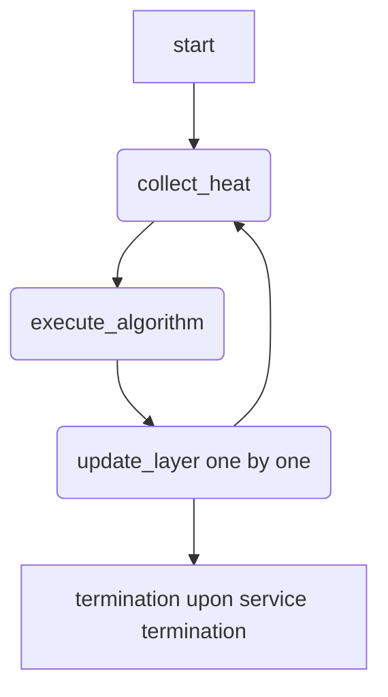

# 专家并行负载均衡器（EPLB）

## 特性介绍

在大语言模型（LLM）推理服务中，专家负载均衡对于 MoE（Mixture of Experts）模型实现最佳性能至关重要。推理过程中动态调整专家分布会对 TTFT（首 Token 延迟）和 TPOT（每 Token 延迟）产生负面影响，因为这需要全局同步暂停，从而阻塞所有正在处理的请求。EPLB 特性旨在最小化这些暂停的影响。

vLLM Ascend 提供两种 EPLB 集成路径：

- Model Runner V2（MRv2）使用上游 vLLM EPLB 控制器、配置、默认策略、负载窗口、异步 worker 和重排生命周期。Ascend 新增了 HIXL 和 Gloo 移动适配器以及 `load_collection_phase` 扩展。
- Model Runner V1（MRv1）保留传统的 vLLM Ascend 动态、录制和静态 EPLB 模式。

两种路径使用不同的开关和配置方案。请勿将 MRv1 环境变量或传统字段与 MRv2 EPLB 配置混用。

EPLB 提供以下收益：

- 降低延迟：通过在专家间均匀分配工作负载，动态平衡专家负载，从而最小化 TTFT 和 TPOT。
- 自适应扩展：自动适应工作负载波动，同时保持稳定性能。

**内容缺失，需要人工补齐。**

### 使用场景

**依据原文上下文内容重组，请进行人工校验。**

EPLB 适用于以下部署场景：

| 场景 | 适用性 | 说明 |
| --- | --- | --- |
| P 节点工作负载，输入序列长度大于 1024 tokens | 推荐 | 较短序列可能无法从 EPLB 中受益。 |
| D 节点工作负载，每 die 专家数不超过 8（950DT Products 上不超过 16）且每 die 负载不低于 128 tokens | 推荐 | 更高的专家密度或更低的负载会降低收益。 |
| 混合部署（P 节点 + D 节点） | 支持 | 使用 MRv1 动态 EPLB 或 MRv2 配合适当的 `load_collection_phase`。 |

以下场景不建议使用 EPLB，因为负载均衡收益可能无法抵消其运行时开销：

- P 节点工作负载，输入序列长度小于 1024 tokens。
- D 节点工作负载，每 die 专家数大于 8（950DT Products 上大于 16），或每 die 负载低于 128 tokens。

!!! warning
    满足上述条件可能导致性能下降。当每 die 专家数约为 8 时，EPLB 的收益可能与开销相当。请对实际工作负载进行基准测试，仅在确认有性能提升后启用 EPLB。

### 约束与限制

**依据原文上下文内容重组，请进行人工校验。**

| 维度 | 约束 |
| --- | --- |
| 硬件 | 950PR&950DT Products 不支持 EPLB 与 W4A8 MXFP4 或 W4A16 MXFP4 量化组合使用。A2 不支持冗余专家；在 A2 上 `num_redundant_experts` 必须设置为 0。所有 NPU 必须具有相同的内存容量和计算能力。网络带宽须支持专家重分布流量（建议至少 10 Gbps）。 |
| 部署场景 | 不建议用于输入序列长度小于 1024 tokens 的 P 节点工作负载。不建议用于每 die 专家数大于 8（950DT Products 上大于 16）或每 die 负载低于 128 tokens 的 D 节点工作负载。容器需挂载 `/dev/shm`。 |
| 模型 | 仅适用于支持专家并行的 MoE 模型，且其 MoE 量化方法须暴露完整的专家权重移动布局。MRv1 性已在 DeepSeek-V3.1/R1 上验证。MRv2 模型级验证使用 Qwen3-30B-A3B W8A8 异步 EPLB。 |
| 特性互斥 | 权重卸载和预取与 Ascend 上的上游 EPLB 不兼容；启用 EPLB 时若 `cpu_offload_gb > 0` 或 `offload_group_size > 0` 会触发配置错误。MRv2 拒绝弹性 EP、传统 `dynamic_eplb`、录制/静态映射字段、`DYNAMIC_EPLB` 和 `EXPERT_MAP_RECORD`，以及 Gloo 和 HIXL 以外的通信器。请勿将 MRv1 环境变量或传统字段与 MRv2 EPLB 配置混用。 |
| 软件依赖 | HIXL 要求每个 EPLB rank 上有 CANN HIXL 运行时和正常工作的设备连接。自动选择要求每个 EPLB rank 上具有相同的 HIXL 绑定类；每个 rank 解析官方 `hixl` Python 包（随 CANN HIXL 分发）或 vllm_ascend 的 ctypes 绑定（直接驱动 `libcann_hixl.so`）。如果任何 rank 没有可用的绑定或绑定不同，整个组将回退到 `torch_gloo` CPU 暂存。 |
| 其他 | 静态 EPLB 计划在 v0.25.1 中移除。生产使用前需独立验证目标模型、拓扑、图模式和流量。 |

MRv2 权重格式支持：

W8A8 由仓库内模型级回归测试覆盖，在 Ascend NPU 上运行。其他已启用格式未经过同等水平的验证，在生产部署前需使用目标模型和硬件配置进行验证。

| 权重格式 | MRv2 EPLB | 说明 |
| --- | --- | --- |
| BF16 / FP16 | 已启用 | 使用未量化的专家权重和偏置。 |
| W8A8 / W8A8 Dynamic | 已启用 | 使用持久化的每专家权重和缩放张量。 |
| W4A8 | 已启用 | 使用持久化的每专家权重、缩放和缩放偏置张量。 |
| W4A4 MXFP4 | 已启用 | 950PR&950DT Products；保留原生 ND 专家张量。 |
| W8A8 MXFP8 | 已启用 | 950PR&950DT Products；保留原生 ND 专家张量。 |
| W4A16 | 拒绝 | 专家权重布局尚未完成独立的 EPLB 验证。 |
| W4A16 MXFP4 | 拒绝 | 专家权重布局尚未完成独立的 EPLB 验证。 |
| W4A8 MXFP4 | 拒绝 | 专家权重布局尚未完成独立的 EPLB 验证。 |

MRv1 量化和硬件支持：

| 量化类型 | 支持的硬件 |
| --- | --- |
| W8A8 / W8A8-Dynamic | A2, A3 |
| W4A8（启用 fused MC2） | A2, A3 |
| MXFP4 | 950PR&950DT Products |
| MXFP8 | 950PR&950DT Products |

## 特性使用

!!! note
    以下示例可能使用非零的 `num_redundant_experts` 来演示冗余专家放置。此设置仅在支持冗余专家的硬件上有效，如 A3 或 950PR&950DT Products。A2 不支持冗余专家；在 A2 上，设置 `num_redundant_experts` 为 0。

### 使用样例

**依据原文上下文内容重组，请进行人工校验。**

MRv2：异步 EPLB

当模型或环境未默认选择 MRv2 时，需显式选择 MRv2。启用专家并行和上游 EPLB。Ascend 选择 STAIR 作为上游策略默认值，并在可用时自动使用 HIXL，否则回退到 Gloo。移动仅异步执行。STAIR 默认值无需调优。

1. 设置环境变量以选择 MRv2 并清除传统 EPLB 环境变量：

   ```bash
   export VLLM_USE_V2_MODEL_RUNNER=1
   unset DYNAMIC_EPLB
   unset EXPERT_MAP_RECORD
   ```

2. 启用 EPLB 启动 vLLM 服务：

   ```bash
   vllm serve Qwen/Qwen3-30B-A3B \
     --tensor-parallel-size 16 \
     --enable-expert-parallel \
     --enable-eplb \
     --eplb-config.window_size 50 \
     --eplb-config.step_interval 50 \
     --eplb-config.num_redundant_experts 16 \
     --eplb-config.use_async true \
     --eplb-config.log_balancedness true \
     --eplb-config.log_balancedness_interval 1 \
     --additional-config '{"eplb_config":{"load_collection_phase":"all"}}'
   ```

   命令中的参数说明：

   - `VLLM_USE_V2_MODEL_RUNNER=1`：选择 MRv2。
   - `--enable-expert-parallel`：启用专家并行。
   - `--enable-eplb`：启用 EPLB。
   - `--eplb-config.window_size`：用于专家负载记录的最近步数。
   - `--eplb-config.step_interval`：专家重排之间的间隔。
   - `--eplb-config.num_redundant_experts`：冗余物理专家数（在 A2 上必须为 0）。
   - `--eplb-config.use_async`：启用异步移动（MRv2 始终异步运行）。
   - `--eplb-config.log_balancedness`：记录专家均衡度指标。
   - `--eplb-config.log_balancedness_interval`：均衡度日志条目之间的间隔。
   - `--additional-config`：传递 `load_collection_phase` 扩展。

3.（可选）仅收集 prefill 负载时，设置 `load_collection_phase` 为 `prefill`：

   ```bash
   vllm serve Qwen/Qwen3-30B-A3B \
     --enable-expert-parallel \
     --enable-eplb \
     --eplb-config.use_async true \
     --additional-config '{"eplb_config":{"load_collection_phase":"prefill"}}'
   ```

预期输出：vLLM 服务在启用 EPLB 后成功启动。当 `log_balancedness` 设置为 true 时，日志按配置间隔包含专家均衡度指标。服务以异步方式运行，使用 HIXL 或 Gloo 作为移动适配器。

---

MRv1：传统 EPLB

传统 MRv1 EPLB 有三种模式：动态 EPLB、录制（生成专家映射）和静态 EPLB（加载预录制映射）。

!!! important
    对于动态 EPLB 和录制模式，环境变量作为安全保护：仅在配置中设置 `dynamic_eplb: true` 不够——断言要求 `DYNAMIC_EPLB=true` 或 `EXPERT_MAP_RECORD=true`。静态 EPLB（通过 `expert_map_path` 加载预录制映射）不需要环境变量。

动态 EPLB

启用自动调优参数的动态负载均衡。根据工作负载模式调整 `expert_heat_collection_interval` 和 `algorithm_execution_interval`。在当前版本中，推荐策略为 SwiftBalanceEplb（2）的 `eplb_policy_type`。

1. 设置安全保护环境变量：

   ```bash
   export DYNAMIC_EPLB="true"
   ```

2. 为 D 节点或混合部署工作负载启动 vLLM 服务：

   ```shell
   # D 节点或混合部署
   vllm serve Qwen/Qwen3-235B-A22B \
     --tensor-parallel-size 16 \
     --enable-expert-parallel \
     --additional-config '{ "eplb_config": {
       "dynamic_eplb": true,
       "expert_heat_collection_interval": 600,
       "algorithm_execution_interval": 50,
       "eplb_policy_type": 2,
       "num_redundant_experts": 16
       }}'
   ```

3. 对于 P 节点工作负载，使用较短的间隔：

   ```shell
   # P 节点
   vllm serve Qwen/Qwen3-235B-A22B \
     --tensor-parallel-size 16 \
     --enable-expert-parallel \
     --additional-config '{ "eplb_config": {
       "dynamic_eplb": true,
       "expert_heat_collection_interval": 50,
       "algorithm_execution_interval": 5,
       "eplb_policy_type": 2,
       "num_redundant_experts": 16
       }}'
   ```

4.（可选）仅收集 prefill 热度时，设置 `eplb_heat_collection_stage` 为 `prefill`：

   ```bash
   export DYNAMIC_EPLB="true"

   vllm serve Qwen/Qwen3-235B-A22B \
     --tensor-parallel-size 16 \
     --enable-expert-parallel \
     --additional-config '{ "eplb_config": {
       "dynamic_eplb": true,
       "expert_heat_collection_interval": 600,
       "algorithm_execution_interval": 50,
       "eplb_policy_type": 2,
       "num_redundant_experts": 16,
       "eplb_heat_collection_stage": "prefill"
     }}'
   ```

   仅收集 decode 热度时，设置 `eplb_heat_collection_stage` 为 `decode`：

   ```json
   {
     "eplb_config": {
       "dynamic_eplb": true,
       "eplb_heat_collection_stage": "decode"
     }
   }
   ```

工作流程图：



预期输出：vLLM 服务在启用动态 EPLB 后启动。日志按配置的收集间隔显示 `[Expert Hotness]` 条目。专家权重按配置的算法执行间隔进行重分布。

---

录制（生成专家映射）

为后续部署生成初始专家分布映射。

1. 设置安全保护环境变量：

   ```bash
   export EXPERT_MAP_RECORD="true"
   ```

2. 使用 `expert_map_record_path` 启动 vLLM 服务：

   ```shell
   vllm serve Qwen/Qwen3-235B-A22B \
     --tensor-parallel-size 16 \
     --enable-expert-parallel \
     --additional-config '{ "eplb_config": {
       "expert_map_record_path": "/path/to/eplb.json",
       "num_redundant_experts": 16,
       "expert_heat_collection_interval": 400,
       "algorithm_execution_interval": 30
     }}'
   ```

预期输出：在充分收集热度后，专家映射 JSON 文件在指定路径生成。该文件可在后续部署中用于静态 EPLB。

---

静态 EPLB（使用录制映射）

!!! warning
    静态 EPLB 计划在 v0.25.1 中移除。

加载预录制的专家映射以获得一致的性能。这避免了运行时重新计算分布。

1. 加载前验证专家映射 JSON 结构：

   ```bash
   jq . /path/to/eplb.json
   ```

2. 使用 `expert_map_path` 启动 vLLM 服务：

   ```shell
   vllm serve Qwen/Qwen3-235B-A22B \
     --tensor-parallel-size 16 \
     --enable-expert-parallel \
     --additional-config '{
       "eplb_config": {"expert_map_path": "/path/to/eplb.json"}
     }'
   ```

预期输出：vLLM 服务使用预录制的专家分布映射启动。静态 EPLB 不需要环境变量。

### 验证特性

**依据原文上下文内容重组，请进行人工校验。**
**内容缺失，需要补充。以下内容基于原文上下文推断，请人工确认：**

1. 在服务日志中跟踪专家热度指标：

   ```bash
   grep "\[Expert Hotness\]" /path/to/vllm.log
   ```

   日志报告每个层在不同 rank 上的负载峰值均值比，然后计算其均值和最大值。Current 表示实际峰值均值比；update 表示算法调整后的估计峰值均值比。

2. 使用 vLLM monitor 检测运行时不均衡：

   ```bash
   vllm monitor
   ```

3. 加载前验证专家映射 JSON 结构（用于静态 EPLB）：

   ```bash
   jq . /path/to/eplb.json
   ```

预期输出：`[Expert Hotness]` 日志条目显示当前和更新后的峰值均值比。较低的更新比值表示 EPLB 成功降低了负载不均衡。vLLM monitor 仪表板反映各 rank 间均衡的专家利用率。对于格式正确的专家映射，`jq` 命令输出有效 JSON 且无错误。

## 配置参数

**依据原文上下文内容重组，请进行人工校验。**

MRv2 EPLB 参数。这些字段通过 `--eplb-config` 传递，不得放在 `--additional-config` 中（`load_collection_phase` 除外）。

| 参数 | 类型 | 默认值 | 必填 | 取值范围 | 说明 |
| --- | --- | --- | --- | --- | --- |
| window_size | int | 1000 | 否 | 正整数 | 用于专家负载记录的最近步数。 |
| step_interval | int | 3000 | 否 | 正整数 | 专家重排之间的间隔。 |
| num_redundant_experts | int | 0 | 否 | 非负整数（A2 上必须为 0） | 冗余物理专家数。 |
| use_async | bool | true | 否 | true, false | Ascend MRv2 始终异步运行。false 会被归一化为 true 并发出警告。 |
| policy | str | stair | 否 | stair, default | 选择 stair 作为 Ascend 策略，或选择 default 用于上游策略对比实验。 |
| log_balancedness | bool | false | 否 | true, false | 记录专家均衡度指标。 |
| log_balancedness_interval | int | 1 | 否 | 正整数 | 均衡度日志条目之间的间隔。 |
| communicator | str | Auto (None) | 否 | hixl, torch_gloo, unset | 不设置时在可用时使用 HIXL，否则使用 Gloo；设置 hixl 或 torch_gloo 可显式选择后端。 |

Ascend 扩展了上游 `policy` 字段，未新增第二个选择器。使用 `--eplb-config.policy default` 运行上游策略；省略或设为 `stair` 运行 STAIR。

`load_collection_phase` 是 `additional_config.eplb_config` 下唯一的 MRv2 EPLB 字段。它控制哪些 batch 阶段贡献到上游负载窗口；它不会禁用不匹配 batch 的路由或 MoE 计算。

| 值 | 行为 | 典型用途 |
| --- | --- | --- |
| all | 从每个 batch 收集负载。这是默认值。 | 通用和混合工作负载。 |
| prefill | 仅从包含至少一个 prefill 请求的 batch 收集。 | 优化 prefill 均衡和 TTFT。 |
| decode | 仅从包含 decode 请求且无 prefill 请求的 batch 收集。 | 优化 decode 均衡和 TPOT。 |

分类每 batch 执行一次。包含任何 prefill 请求的 batch 完全分类为 prefill；否则为 decode。不匹配 `load_collection_phase` 的 batch 在当前步记录时贡献零负载；它不会抑制共享 EPLB 窗口推进。这保持了负载窗口槽位、调度和通信在数据并行 rank 间对齐。

---

MRv1 EPLB 参数。这些字段通过 `--additional-config` 中的 `eplb_config` 传递。

| 参数 | 类型 | 默认值 | 必填 | 取值范围 | 说明 |
| --- | --- | --- | --- | --- | --- |
| dynamic_eplb | bool | false | 否 | true, false | 启用动态 EPLB。需要 `DYNAMIC_EPLB=true` 环境变量作为安全保护。 |
| expert_heat_collection_interval | int | 600 | 否 | 正整数 | 收集专家热度的间隔。 |
| algorithm_execution_interval | int | 50 | 否 | 正整数 | 执行均衡算法的间隔。 |
| eplb_policy_type | int | 2 | 否 | 0, 1, 2, 3 | EPLB 策略类型。见下方策略类型参考。 |
| num_redundant_experts | int | 0 | 否 | 非负整数（A2 上必须为 0） | 冗余专家数。 |
| eplb_heat_collection_stage | str | all | 否 | all, prefill, decode | 用于收集专家热度的请求阶段。见下方阶段参考。 |
| expert_map_record_path | str | - | 否 | 文件路径 | 录制专家映射的路径（录制模式）。 |
| expert_map_path | str | - | 否 | 文件路径 | 加载预录制专家映射的路径（静态 EPLB 模式）。 |

`eplb_policy_type` 值参考：

| 值 | 策略 | 说明 |
| --- | --- | --- |
| 0 | Random | 在 rank 间随机交换专家。仅适用于基础测试。 |
| 1 | DefaultEplb | 开源 EPLB 算法。将冗余专家添加到最热门的专家，通过均衡分配和局部约束交换进行打包。 |
| 2 | SwiftBalanceEplb | 针对低带宽环境优化。支持节点内和节点间专家冗余，联合优化专家放置。（推荐） |
| 3 | FlashLB | 使用专家负载的滑动窗口均值/方差/协方差的统计方法。使用 FlashTree 分层搜索进行最优副本分配，使用 `minimize_redeploy` 进行增量调整。适用于高频负载波动。 |

`eplb_heat_collection_stage` 值参考：

!!! important
    此字段仅适用于 MRv1。MRv2 使用 `load_collection_phase`；两个字段具有不同的 batch 分类语义，不可互换。

| 值 | 行为 | 典型用途 |
| --- | --- | --- |
| all | 从 prefill 和 decode 迭代中收集专家热度。 | 通用工作负载；这是默认值。 |
| prefill | 仅从分类为 prefill 的迭代中收集专家热度。 | 优化 prefill 工作负载均衡和 TTFT。 |
| decode | 仅从分类为 decode 的迭代中收集专家热度。 | 优化 decode 工作负载均衡和 TPOT。 |

!!! note
    阶段选择适用于动态 EPLB 热度收集。在内部，vLLM Ascend 通过将每次前向迭代的填充调度 token 数与 decode 迭代的最大预期 token 数进行比较来分类每次前向迭代。高于阈值的迭代被视为 prefill；等于或低于阈值的迭代被视为 decode。分类按前向迭代执行，而非按单个请求。当迭代不匹配所选阶段时，其专家负载不被累积，也不推进热度收集间隔。

## 调优建议

**内容缺失，需要补充。以下内容基于原文上下文推断，请人工确认：**

1. 参数调优：

   - 对于 MRv2，根据目标工作负载调优 `window_size` 和 `step_interval`。
   - 对于 MRv1，根据工作负载模式调优 `expert_heat_collection_interval` 和 `algorithm_execution_interval`。
   - `num_redundant_experts` 必须使 `(num_experts + num_redundant_experts)` 可被专家并行大小整除。

2. 热度收集阶段选择（MRv1）：

   - 对于典型输入序列长度大于 1024 tokens 的工作负载，从 `prefill` 开始。
   - 对于典型输入序列长度小于 1024 tokens 但并发大于 1024 的工作负载，尝试 `decode` 或 `all`。
   - 对于其他或混合工作负载，在选择设置前针对目标 TTFT 或 TPOT 对 `all`、`prefill` 和 `decode` 进行基准测试。

   这些阈值是经验性的起始点，而非严格要求。生产流量分布、并发、模型配置和硬件拓扑都会影响最佳阶段。

3. 通信器和迁移限制（MRv2）：

   - STAIR 默认将每 rank 和跨节点迁移限制保持不受限制（-1），以便 HIXL 可以使用可用带宽。
   - 当通信器自动回退到 Gloo 时，Ascend 仅将未显式设置的限制钳制为 1，以避免过多的 CPU 暂存传输；显式配置的值保持不变（例如 `cross_node_transfer_limit: 0` 仍禁止跨节点迁移），并记录警告。
   - 显式设置 `torch_gloo` 或 `hixl` 也保持配置的限制不变。

4. 硬件要求：

   - 确保所有 NPU 具有相同的内存容量和计算能力。
   - 网络带宽须支持专家重分布流量（建议至少 10 Gbps）。
   - 容器需挂载 `/dev/shm`。
